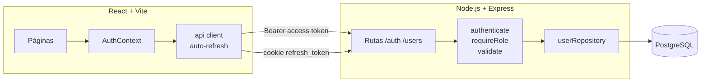

# Gestión de Usuarios y Roles

[](https://github.com/jsonmunoz-dev/gestion-usuarios-roles/actions/workflows/ci.yml)


[](LICENSE)

Sistema web full stack con **autenticación JWT** y **control de acceso basado en roles (RBAC)**.
Tiene tres roles (`admin`, `editor` y `viewer`) y cada uno ve y puede hacer cosas distintas, tanto en la API como en la interfaz.

## Funcionalidades

- Login con email y contraseña. Las contraseñas se guardan con **bcrypt**.
- **Access token** de corta duración (15 min) guardado solo en memoria, más un **refresh token** en cookie `httpOnly` + `SameSite=Strict`.
- **Revocación de sesiones**: al cerrar sesión, cambiar el rol o desactivar a un usuario, se invalidan todos sus refresh tokens mediante `token_version`.
- Autorización por rol en la API (`requireRole('admin')`) y en el frontend (`<ProtectedRoute roles={[...]}>`).
- Validación de datos con **zod** y errores con detalle por campo.
- Reglas de negocio: un admin no puede eliminarse, desactivarse ni quitarse el rol a sí mismo.
- Seguridad básica: `helmet`, CORS restringido, consultas SQL parametrizadas y el mismo mensaje de error para email inexistente o contraseña incorrecta (así no se puede averiguar qué emails existen).

## Permisos por rol

| Acción                          | admin | editor | viewer |
| ------------------------------- | :---: | :----: | :----: |
| Ver su perfil (`GET /users/me`) |  ✅   |   ✅   |   ✅   |
| Listar usuarios                 |  ✅   |   ✅   |   ❌   |
| Crear / editar / eliminar       |  ✅   |   ❌   |   ❌   |

## Arquitectura



La app de Express recibe sus dependencias (`createApp({ userRepo, tokenService, config })`). Gracias a eso, los tests unitarios usan un repositorio en memoria y no necesitan base de datos.

```
├── client/                 # React 19 + Vite + React Router
│   └── src/
│       ├── api/            # fetch con renovación automática del token
│       ├── auth/           # AuthContext (sesión y roles)
│       ├── components/     # ProtectedRoute, Layout
│       ├── pages/          # Login, Inicio, Usuarios
│       └── test/           # Vitest + Testing Library
├── server/                 # Node.js + Express 5
│   ├── src/
│   │   ├── db/             # pool, migraciones SQL, seed
│   │   ├── middleware/     # auth, roles, validación, errores
│   │   ├── repositories/   # acceso a datos
│   │   ├── routes/         # /api/auth, /api/users
│   │   └── services/       # emisión y verificación de JWT
│   └── tests/              # Jest + Supertest (unitarios e integración)
└── docker-compose.yml
```

## Cómo ejecutarlo

### Opción 1: Docker (recomendado)

```bash
cp .env.example .env        # edita los secretos JWT
docker compose up --build
```

Abre http://localhost:8080. La API aplica las migraciones y crea los usuarios demo al arrancar.

### Opción 2: Local

Requisitos: Node.js 20.19+ y PostgreSQL 14+.

```bash
# API
cd server
cp ../.env.example .env     # ajusta DATABASE_URL y los secretos
npm install
npm run db:migrate && npm run db:seed
npm run dev                 # http://localhost:4000

# Cliente (en otra terminal)
cd client
npm install
npm run dev                 # http://localhost:5173 (proxy de /api a :4000)
```

### Usuarios demo

| Email          | Contraseña | Rol    |
| -------------- | ---------- | ------ |
| admin@demo.cl  | Demo1234!  | admin  |
| editor@demo.cl | Demo1234!  | editor |
| viewer@demo.cl | Demo1234!  | viewer |

## API

| Método | Ruta                | Acceso        | Descripción                                          |
| ------ | ------------------- | ------------- | ---------------------------------------------------- |
| POST   | `/api/auth/login`   | Público       | Devuelve el access token y deja la cookie de refresh |
| POST   | `/api/auth/refresh` | Cookie        | Renueva el access token                              |
| POST   | `/api/auth/logout`  | Autenticado   | Revoca las sesiones y borra la cookie                |
| GET    | `/api/users/me`     | Autenticado   | Perfil propio                                        |
| GET    | `/api/users`        | admin, editor | Listado paginado (`?page=&pageSize=`)                |
| POST   | `/api/users`        | admin         | Crear usuario                                        |
| PATCH  | `/api/users/:id`    | admin         | Cambiar nombre, rol o estado                         |
| DELETE | `/api/users/:id`    | admin         | Eliminar usuario                                     |

Ejemplo:

```bash
curl -X POST http://localhost:4000/api/auth/login \
  -H "Content-Type: application/json" \
  -d '{"email":"admin@demo.cl","password":"Demo1234!"}'
```

## Tests

```bash
cd server && npm test                 # unitarios (sin base de datos)
cd server && npm run test:integration # requiere DATABASE_URL apuntando a PostgreSQL
cd client && npm test                 # componentes React
```

El pipeline de **GitHub Actions** corre lint y tests del servidor y del cliente, los tests de integración contra un servicio PostgreSQL 16 y el build de las imágenes Docker.

## Próximos pasos

- Recuperación de contraseña por email.
- Limitar los intentos de login (rate limiting).
- Auditoría de cambios de rol (quién cambió qué y cuándo).
- Tests end-to-end con Playwright.

## Autor

**Jheyson Muñoz**: estudiante de Analista Programador en INACAP Valparaíso.
[GitHub](https://github.com/jsonmunoz-dev)

## Licencia

[MIT](LICENSE)
